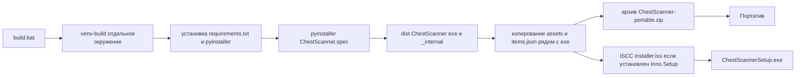

# План: автономная сборка Chest Scanner без Python у пользователя

## Цель

Упаковать приложение в Windows-программу так, чтобы на машине пользователя
не требовался Python: ни `.venv`, ни `pip`, ни установка интерпретатора.
Всё собирается один раз на машине разработчика и раздаётся как установщик
или портативный архив.

## Подход — как у «нормальных программ»

1. **PyInstaller (onedir)** — стандарт для Python-десктопа на Windows.
   Сборка в папку `ChestScanner.exe` + `_internal` (библиотеки).
   Старт быстрее onefile, меньше ложных срабатываний антивируса.
2. **Inno Setup** — настоящий установщик: per-user установка в
   `%LocalAppData%\Programs\ChestScanner` (без прав администратора),
   ярлыки рабочего стола и меню «Пуск», деинсталлятор, версия и иконка.
3. **Портатив** — zip-архив той же onedir-папки (бонус, для «зелёного»
   распространения).
4. **Подпись кода** — единственный платный шаг (сертификат), снижает
   предупреждения SmartScreen/Defender. Выносится за скобки как опция.

## Почему правки кода не нужны

- [`IS_FROZEN`](chest_scanner/app_bootstrap.py:36) — флаг уже есть;
  `BASE_DIR_FOR_APP = dirname(sys.executable)` в frozen-режиме указывает
  на каталог с exe.
- [`_ensure_venv()`](chest_scanner/app_bootstrap.py:120) сразу выходит
  при `IS_FROZEN` — бутстрап `.venv` в собранном exe не выполняется.
- [`absolute_path()`](chest_scanner/commons.py:17) резолвит относительные
  пути (`assets/...`, `items.json`, `profiles/`, `results/`, `items/`,
  `unknown_items/`, `logs/`) относительно каталога exe → все данные
  приложения (конфиг, база предметов, изображения, отчёты) лежат рядом
  с exe и доступны на запись.

Отсюда правило сборки: **ассеты и `items.json` НЕ бандлить внутрь exe или
`_internal/`** — их копирует build-скрипт рядом с exe (иначе код их не найдёт,
т.к. ищет в каталоге exe, а не в `sys._MEIPASS`).

## Что создаём

| Артефакт | Назначение |
|---|---|
| `version_info.txt` | Версия, ProductName «Chest Scanner», описание, компания |
| `build/icon.ico` | Иконка exe и установщика (генерится из `assets/chest_open.png`) |
| `ChestScanner.spec` | Конфиг PyInstaller (onedir, `console=False`, `tzdata`, version, icon) |
| `build.bat` | Полный конвейер сборки на машине разработчика |
| `installer.iss` | Скрипт Inno Setup (установщик + деинсталлятор) |
| `dist/ChestScanner/` | Готовая папка: exe + `_internal` + `assets/` + `items.json` |
| `dist/ChestScanner-portable.zip` | Портативный архив (zip папки выше) |
| `dist/ChestScannerSetup.exe` | Установщик (если установлен Inno Setup) |

## Конвейер сборки

## Шаги

### 1. `version_info.txt`

VSVersionInfo: `FileVersion`/`ProductVersion` (например 1.0.0),
`FileDescription=«Chest Scanner»`, `ProductName=«Chest Scanner»`,
`InternalName=«ChestScanner»`, `OriginalFilename=«ChestScanner.exe»`,
`CompanyName`, LegalCopyright. Так в свойствах exe будет нормальная
карточка, как у обычных программ.

### 2. Иконка `build/icon.ico`

Скрипт на Pillow (PIL уже в `requirements.txt`): берёт
`assets/chest_open.png`, ресайзит в набор размеров 16/24/32/48/64/128/256
и сохраняет `.ico` в `build/`. Иконка подключается в spec и в `installer.iss`.

### 3. `ChestScanner.spec`

- `Analysis(['main.py'])` — весь код импортируется статически, скрытых
  импортов не требуется.
- `console=False` — GUI-режим (аналог `pythonw`, как сейчас запускает
  `start.bat`).
- `--collect-data tzdata` — обязателен: на Windows нет базы часовых поясов
  IANA, без `tzdata` сломается `ZoneInfo("Europe/Moscow")` в [logging_setup](chest_scanner/logging_setup.py:7).
- `icon='build/icon.ico'`, `version='version_info.txt'`.
- **UAC-манифест**: `requireAdministrator` — горячие клавиши `keyboard`
  (F6–F10) работают только из-под админа; манифест гарантирует их работу
  без ручного «Запуск от имени администратора». Цена: UAC-запрос при каждом
  запуске. Опция выключается одной строкой в spec.
- Внутрь сборки НЕ добавляем `assets/` и `items.json` — они копируются
  build-скриптом в `dist/ChestScanner/` (см. правило выше).

### 4. `build.bat`

1. Создаёт отдельное окружение `.venv-build` (не трогает рабочий `.venv`).
2. `pip install -r requirements.txt pyinstaller`.
3. Генерирует `build/icon.ico`.
4. Запускает `pyinstaller ChestScanner.spec --noconfirm --clean`.
5. Копирует `assets\` → `dist\ChestScanner\assets\`, `items.json` →
   `dist\ChestScanner\`.
6. Собирает портатив: `Compress-Archive` (PowerShell) →
   `dist\ChestScanner-portable.zip`.
7. Если найден `ISCC.exe` (Inno Setup) — компилирует `installer.iss` →
   `dist\ChestScannerSetup.exe`; иначе пропускает с предупреждением.

Первый пользователь данных (config.json, results/, items/, unknown_items/,
logs/) создаётся приложением при первом запуске — `config.json` в комплект
НЕ входит.

### 5. `installer.iss` (Inno Setup)

- `PrivilegesRequired=lowest` → per-user установка в
  `{localappdata}\Programs\ChestScanner`, админ не нужен.
- `AppId` (UUID), `AppName=«Chest Scanner»`, версия из `version_info.txt`.
- Устанавливает: exe, `_internal`, `assets`, `items.json`.
- Ярлыки: рабочий стол + меню «Пуск», `AppMutex` для защиты от двойного
  запуска во время установки.
- Деинсталлятор создаётся штатно; данные профиля (config/results), созданные
  после установки, при удалении остаются (рекомендация в README).

### 6. `.gitignore`

Добавить `/dist/`, `/build/`, `/.venv-build/` — артефакты сборки
не должны попадать в репозиторий (spec и .iss храним).

### 7. README

- Новый раздел «Установка без Python»: запуск `ChestScannerSetup.exe`
  или распаковка портатива; права администратора (UAC) для горячих клавиш.
- Новый раздел «Сборка из исходников»: `build.bat`, требования к машине
  разработчика (Python 3.10+, Inno Setup опционально).
- Примечания: ложные срабатывания Defender у свежих PyInstaller-сборок
  (онedir минимизирует), платная подпись кода как решение; перенос данных
  между ПК = копирование папки установки; удаление программы не удаляет
  отчёты.

### 8. Чек-лист проверки собранного exe

- Запуск из `dist\ChestScanner\ChestScanner.exe` без консоли.
- Мастер первого запуска (имя профиля, webhook).
- F8-сканирование сундука, отладка сетки F7/цифр F6, калибровка.
- F9-отправка в Discord, экспорт CSV/JSON.
- Горячие клавиши работают (проверять из-под админа).
- Перезапуск: конфиг, база предметов, отчёты сохраняются в папке exe.

## Риски и оговорки

- **Антивирус**: слабо подписанные PyInstaller-сборки изредка ловят
  ложные срабатывания. Смягчение уже в плане: onedir. Радикальное
  решение — подпись кода (платно) или переход на Nuitka (выше время
  сборки) — вне рамок задачи.
- **UAC**: если отключить `requireAdministrator`, горячие клавиши снова
  требуют ручного запуска от имени администратора (как в README сейчас).
- **Только Windows**: сборка и запуск экзешника — Windows-only; на Linux/mac
  проект собирается из исходников.